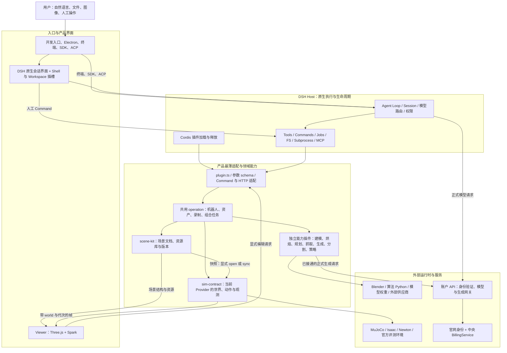

# Lyapunov 开发原则（历史归档，2026-10-25）

> **历史身份**：本文件是旧 `docs/DEVELOPMENT_PRINCIPLES.md` 的原文归档，不是现行开发原则，也不得作为当前实现的验收依据。
>
> **原文核对日期**：2026-09-19（原文正文所载；2026-10-25 归档时与工作树原文逐字核对）。
>
> **归档日期**：2026-10-25。
>
> **现行入口**：[核心原则总入口](../principles/README.md) · [现行开发原则](../principles/DEVELOPMENT.md)
>
> **保留方式**：以下分界标记之后为旧文档原文，逐字保留；旧相对链接按原样保留，不随新目录修正。

<!-- ===== 旧文档原文开始 ===== -->
# Lyapunov 开发原则

本文规定 Lyapunov 的架构边界、接口语义和功能判定方式。依据是当前开发仓库的实现；具体工作步骤见 [开发标准与流程](DEVELOPMENT_STANDARDS.md)，用户操作见 [README](../README.md)。

当前开发问题以 [开发问题 TODO](DEVELOPMENT_TODO.md) 为入口；历史已解决问题及回执索引见 [已解决问题](RESOLVED_ISSUES.md)。这三类文档分别回答“应当怎样构造”“还缺什么”“哪些问题在什么范围内已有证据”，不互相代替。

核对日期：2026-09-19。对应工作树的基准提交为 `d562e421a7c4da6792441713ee71566b4c03ebbf`，包含核对时尚未提交的代码。下文的“应”“必须”是开发约束；当前尚未一致的地方集中列在标准文档的“接口与冗余核对”中。

## 0. 整体架构与最薄层总要求

**Lyapunov 是建立在 DSH 原生运行时上的三维与物理能力扩展。产品层采用完成用户功能所需的最薄实现，直接复用 DSH 已有服务，只实现 DSH 没有的领域数据、真实算法、引擎适配和必要界面。**

“最薄”约束的是重复责任、状态和执行通路，不是文件长度、服务数量或插件数量。`ctx.scene`、`ctx.sim` 是领域合同，不是新的通用平台；一个操作可以包含真实的几何处理、规划和物理控制，但不能因此再造第二套会话、Agent Loop、Jobs、权限或事件总线。

### 0.1 完整结构



图中的箭头表示职责与数据流，不能理解成每次操作都必须经过所有模块。纯场景编辑无需启动模拟；读取物理帧无需调用语言模型；规划输出轨迹后，只有显式执行才改变物理世界。正式生成经**远端账户 API**中转（该服务已移出本仓）；本仓保留客户端与 HTTP 合同，正式商业链路以实际部署与授权为准。

### 0.2 分层、目录与依赖方向

| 层 | 当前目录／实现 | 允许承担 | 不应承担 |
| --- | --- | --- | --- |
| 入口与装配 | `script`、`desktop`、`lyapunov-product-bundle`、`distribution` | 解析配置、验证账户、创建 Profile／Host、选择与装配插件、拥有和释放所启进程 | 重写领域算法、每个入口各维护一套引擎默认规则 |
| DSH 原生底座 | 固定 `.upstream` 检出及登记补丁 | Agent、会话、模型、工具、Commands、Jobs、权限、文件和子进程、插件生命周期 | 产品另建同义内核；把领域对象塞进上游核心 |
| 产品适配层 | 各 `plugin.ts`、`tool-schema.ts`、Shell／Workspace 的 HTTP 与客户端适配 | 参数转换、注册、原生信号连接、结果呈现、会话身份传递 | 在 Tool、Command、HTTP 中分别复制业务，静默换模型／世界／用户 |
| 领域与组合层 | `scene-kit`、`robot-tools`、`robot-workflows`、合同包 | 场景和资源规则、稳定动作语义、有限步骤组合、来源与结果事实 | 新建任务调度器、私有 Goal Store、第二套机器人注册资格平台 |
| Provider 与外部执行层 | `sim-*`、`motion-*`、`grasp-*`、`generate-*`、`segment-*`、`blender`、`policy-registry`、`benchmark-*` | 真正执行 SDK／算法／供应商请求，适配独立依赖，返回能力与结果 | 把 Provider 私有状态交给 Viewer 修改，算法插件直接接管别人的物理时钟 |
| 显示与工作区层 | `viewer`、`lyapunov-shell`、`lyapunov-workspace`、原生 UI 槽位 | 图形、文件、面板、选择、输入与人工操作；消费来源明确的投影 | 在 rAF 中步进物理、另存权威场景／钱包、由画面动画冒充物理动作 |
| 账户服务边界 | 远端账户 API（独立运维仓库；已不在本仓） | 正式身份、中央账单适配、模型与已接通生成网关 | 承担桌面 Agent Loop；在中央账单模式再建消费者钱包真值 |

依赖由入口向下装配，由消费者面向共享合同调用；Provider 可以依赖合同及其专属 SDK，不能反向依赖 Shell／Viewer。界面通过原生工具／Command 或现有 HTTP 投影操作领域，不能直接操纵引擎内存。

文件可拆分用于独立维护；新增插件需要对应独立状态、依赖、生命周期或替换需求。一个工具、一个按钮或一个 helper 本身不足以成为新插件的理由。

### 0.3 四条必须保持单一实现的通路

| 通路 | 允许的结构 | 保持薄层的方法 |
| --- | --- | --- |
| 自然语言操作 | 用户消息 → DSH Agent → Tool → 共用 operation → 领域／Provider → 回执 | 产品提供工具和结果，不再写自己的 ReAct／Agent Loop |
| 人工已知操作 | UI → 原生 Command／现有 RPC → 同一 operation → 结果 | 点击“停止”不先询问模型，按钮与模型不各写一份物理控制 |
| 文档与物理同步 | Scene 原子提交 → 显式 `sim.sync` → 新 handle／frame → Viewer | 文档版本、模型代次和物理步分别管理，不逐帧回写 Scene |
| 建模与算法 | DSH Tool／Job → 独立 Blender／Python／远端 API → 资产、候选或计划 → 显式导入／执行 | 无私有模型客户端和常驻业务循环；算法输出不能越界控制当前世界 |

### 0.4 进程、会话与资源边界

```text
一个产品实例
  └─ 一个 DSH Host / Profile（装配一个 Sim Provider 类型）
       ├─ 会话 A、会话 B……：各自拥有消息与工具调用来源
       ├─ Scene / 资源命名空间：每会话一套 <域根>/sessions/<会话键>
       │    （scene.forSession()：各自的世界、资产、机器人、缓存与目录索引）
       └─ Sim 命名空间：每会话一套世界服务实例
            （SessionSimFactory：按会话创建 Provider 实例）
            ├─ MuJoCo：该会话 worker 内多个独立 World
            └─ Isaac：该会话 Provider 里的每个 world 独立 Kit / PhysX 进程

Viewer：读取当前会话的 Scene 与 World；页面布局与物理状态分离
```

会话（`agent.session.header.id`）是运行态归属键，不再只是消息容器：Scene、资源、机器人和世界服务都按 `<域根>/sessions/<会话键>` 建立命名空间，取不到会话一律明确失败，跨会话的非法目标操作得结构化错误，而不是落回全局共享状态。旧版“同一 Host 的会话共用一套 Scene 与一个世界服务、A 加载环境会覆盖 B”的共享世界问题已按会话归属修正。这只说明**归属规则**已按会话落地，不等于“任意并发隔离已验收”：四会话回执（[DEV003-198](../bugfixHistory/DEV003-198-FOUR-SESSIONS-20260926.md)）当时留有四项局限，DRACO 解码此后已补代码并有测试，但包含该修复的完整四会话图形复验仍未在最新包上重做；同一会话的多个窗口也没有完整的显示控制权隔离。另有一个现存约束：同一 Cordis realm 只装配一个 Sim Provider（一个 Host 一种引擎），需要不同引擎要另起 Host。不得从“每个实体有 ID”或“已有按会话命名空间”推导出“所有会话已经在任意组合下互不干扰”。

独立实验可以用不同 `sceneId`／`worldId`；需要不同引擎、不同运行数据或进程故障隔离时，使用独立 Host。若未来显式引入跨会话共享世界，协作应明确谁控制、谁观察，并复用原生会话身份与现有 Sim 边界处理控制权；不为此再建一个通用多代理平台。

代码依据：[会话命名空间](../packages/lyapunov-contracts/src/session-scope.ts)、[按会话世界服务](../packages/sim-contract/src/session-provider.ts)、[装配表](../script/runtime-patch.ts)、[Host](../script/host.ts)、[MuJoCo worker](../packages/sim-mujoco/python/worker.py)、[Isaac Provider](../packages/sim-isaac/src/provider.ts)、[工作台会话选择](../packages/lyapunov-shell/src/plugin.ts)、[页面显示状态](../packages/lyapunov-shell/src/workbench-ui.ts)。

架构沿用 [最初核心思路](../goals/2026-09-06-lyaup-core-ideas.md) 和 [执行合同](../goals/REFACTOR_EXECUTION_CONTRACT.md) 的责任边界。历史文档中的接口成员、文件路径和进度以当前源码及问题账本校正，不照搬旧“已完成”状态。

## 1. 产品以自然语言、代码与三维物理交互共同组织工作

用户应能在同一个工作台中提出任务、修改文件、构造场景、操作机器人并观察结果。对话、文件、场景和仿真之间通过明确的接口衔接，不另外搭建一套只在界面中存在的执行流程。

- 自然语言任务交给 DSH 的 Agent、Tools、Commands、Jobs 和 Session。
- 人工操作调用与模型工具相同的领域操作，保留各自的调用来源。
- 文件、场景、动作、图像、录制和分享产物应能从当前会话与工作区找到。
- 一个工具的完成状态只描述它实际完成的事情。例如“夹爪闭合”与“物体被成功抓起”分别报告。

代码依据：[运行装配](../script/runtime-patch.ts)、[场景工具](../packages/scene-kit/src/plugin.ts)、[机器人工具](../packages/robot-tools/src/plugin.ts)、[工作台](../packages/lyapunov-shell/src/workbench.tsx)。

## 2. 每一种状态都有唯一的权威维护方

| 状态或能力 | 权威维护方 | 消费方的职责 |
| --- | --- | --- |
| Agent 执行、会话事件、工具调用、任务与取消 | 固定版本的 DSH 上游 | 产品通过插件与公开接口扩展 |
| 场景结构、实体、层级、资源引用和文档版本 | `scene-kit` 的 `SceneStore`、`SceneOperations` | 通过 `ctx.scene` 或领域操作读取、提交 |
| 资源来源、版本、默认组件、依赖与目录索引 | `scene-kit` 的 `ResourceLibrary` | 引用资源身份，不另建同义资源账本 |
| 运行世界、物理时钟、执行器、动作与实测帧 | 当前 `ctx.sim` Provider | 通过 `SimService` 操作和订阅 |
| 可视化、选中项、相机视角、显示开关 | Viewer 与工作台界面 | 显示文档和实测帧，发出显式编辑请求 |
| 模型供应商凭据和生成任务远端状态 | 对应 Provider／账户 API | 展示任务状态与产物，不伪造结果 |
| 正式账户身份与消费者余额 | 官网身份服务、中央 BillingService | API 负责验证、转换协议和调用账单服务 |
| 运行目录与账户隔离 | `runtime-paths.ts`、Profile 和 Host 入口 | 复用解析结果，不在组件中猜绝对路径 |
| 引擎偏好 | `engine-preference.ts` | 设置界面读写偏好；`launch.ts`、`developer.ts`、`architecture.ts` 与桌面经 `startWebHost` 共用同一份 `resolveEngine()` 优先级（09-27 源码核对），设置界面只写下次启动偏好 |

“唯一维护方”不等于只允许一份展示数据。客户端缓存、会话投影、录制快照都可以存在，但必须带有来源身份，不能反过来覆盖权威状态。

代码依据：[共享类型](../packages/lyapunov-contracts/src/types.ts)、[Scene 服务](../packages/scene-kit/src/plugin.ts)、[Sim 合同](../packages/sim-contract/src/index.ts)、[运行目录](../packages/lyapunov-product-bundle/src/runtime-paths.ts)。

## 3. 复用 DSH 原生执行体系

新增业务能力优先落在领域 operation，再由薄插件注册成 Tool、Command 或界面接口。

1. `plugin.ts` 负责服务注入、参数定义、注册和生命周期连接。
2. operation／adapter 负责领域行为；同一行为不能在 Tool、Command、HTTP 三处分别实现。
3. 长任务使用 `ctx.jobs`；向下传递原生取消信号。
4. 组合工作流复用已有工具和 `ctx.sim`，不创建新的 Agent Loop 或会话存储。
5. 插件卸载返回真实清理 Promise；释放自己创建的订阅、进程和世界。
6. 上游变更通过固定提交与补丁管理，不能只改 `.upstream` 或已构建的 `lib/dist` 文件。

当前 `robot_pick`／`robot_place` 使用 `ctx.tools.execute` 调用 `motion_plan`；生成、策略执行和录制使用 DSH Jobs。这些是扩展现有执行体系的参考实现。

### 3.1 最薄适配层的具体标准

| 位置 | 必须做 | 不增加的重复层 |
| --- | --- | --- |
| `ctx.scene` | 稳定地暴露文档读取、提交、订阅与清单；当前四个成员为 `snapshot/commit/subscribe/list` | 另建巨型 SceneCore、复制资源目录或把仿真时钟塞进文档服务 |
| `ctx.sim` | 包住世界、动作、停止、观测和能力差异；按明确 world 与代次执行 | 为每个机器人实例生成一套专属服务、将引擎对象泄漏给界面 |
| Tool／Command | 校验各自边界参数，然后进入同一 operation；传递原生取消与身份 | 为人工按钮、模型工具、HTTP 各维护一次领域状态机 |
| Provider | 把稳定合同转换成真实 SDK／协议；保留实际限制和原始结果来源 | 伪装所有引擎功能等价、用无意义成功对象填补未实现接口 |
| 工作流 | 组合已有候选、规划与动作；有限步骤，明确终止条件与结果 | 自建循环推理、暗中无限重试、逐关节语言回合、固定小关卡反复阻断 |
| UI 与通信 | 使用原生槽位、连接、事件和已有投影；按需要增添产品视图 | 通用万能 Bridge、重复事件总线、第二套会话／终端／权限 owner |
| 外部应用与素材适配 | 使用已有 SDK、MCP、文件格式和下载实现；补必需的产品语义 | 已有 Blender MCP 可用时另建同义服务器，围绕一次下载搭建通用平台 |
| 迁移与上游补丁 | 只保留真实消费者需要的兼容与固定补丁 | 无调用者的永久兼容路径、在多个位置维护同一默认或映射表 |

最薄层仍应保留实际必要的参数、单位、实例代次、写入互斥、停止确认和物理结果判定。校验应放在能掌握事实的负责层；传输层做协议校验，领域层做业务与版本校验，引擎层做真实能力和控制边界检查，避免每层重复同一前置流程。

### 3.2 新增一层之前的判定

先回答：上游是否已有能力；能否直接扩展已有 operation 或 Provider；新增代码拥有什么独立状态；没有这层是否无法完成当前功能；移除后由谁承担同一责任。如果唯一理由是“以后可能复用”或“这样文件更整齐”，先不增加层。

审查时看一件事从入口到结果经过多少转换、同一事实写了几处、替换 Provider 要改多少无关包。重复的适配或状态应收敛；真实算法复杂度不应为追求短文件而被删除。

代码依据：[组合工作流](../packages/robot-workflows/src/plugin.ts)、[生成插件](../packages/generate-marble/src/plugin.ts)、[策略插件](../packages/policy-registry/src/plugin.ts)、[上游补丁装配](../script/upstream-patches.mjs)。

## 4. 场景文档、物理世界与显示相互独立

`SceneSnapshot` 表示持久场景；`WorldHandle` 表示运行世界；`Frame` 表示某个物理时刻的观测。它们不是同一个对象的三种名字。

- `scene_edit` 提交文档；`sim_sync` 把当前文档交给指定世界。提交成功而同步失败时，保留文档并报告同步错误。
- 同一 Cordis realm 只装配一个 Sim Provider，但这个 Provider 可以管理多个 `worldId`。不能把这一限制误写成“整个产品只能有一个世界”。
- Viewer 的刷新与插值只改变显示，不推进物理时钟。
- 查看旧录制不会重新执行机器人动作，也不会把历史帧变成当前物理状态。
- `sim_close` 释放运行世界，不删除场景文档或用户资产。
- 引擎在 Host 启动时装配。修改偏好不等于热切换；需要使用读取该偏好的入口重启，显式 `--engine` 或开发 YAML 仍可覆盖它。

**产品默认策略为 Isaac 优先，Isaac 运行时未就绪时回退 MuJoCo，并说明回退理由。** `engine-preference.ts` 的 `resolveEngine()` 是唯一优先级，所有正常启动入口共用：显式 `--engine` ＞ `LYAPUNOV_SIM_ENGINE` ＞ 用户偏好 ＞ 代码默认。公开开发 YAML 已不再写死 `engine`（省略即跟随共享默认，需要固定引擎时才显式写一行并作为显式覆盖压过环境变量）；桌面入口不再在缺环境变量时传入 `none`；建筑入口不再写死 `mujoco`。旧 09-19 基准记录的“开发 YAML 显式 `mujoco`／桌面默认 `none`／建筑默认 `mujoco`”是**当时**的入口构成，按 09-27 源码已不成立；这几条入口偏差不再是当前待统一项。

代码依据：[SceneStore](../packages/scene-kit/src/store.ts)、[Python Provider 传输与生命周期](../packages/sim-contract/src/python-transport.ts)、[Viewer](../packages/viewer/src/index.ts)、[引擎偏好](../script/engine-preference.ts)。

## 5. 身份、版本与坐标必须明确

跨模块数据使用可序列化合同，不传递 MuJoCo、Isaac、Three.js 等引擎对象。

| 字段 | 语义 | 使用要求 |
| --- | --- | --- |
| `sceneId`、`revision` | 场景身份与文档版本 | 文档写入携带 `expectedRevision` |
| `resourceId`、`version` | 资源身份与来源版本 | 实例引用明确版本，派生表示保留来源 |
| `worldId`、`worldGeneration` | 运行世界与模型代次 | 动作携带 `expectedGeneration` |
| `entityId` | 场景／世界内的实体 | 不用显示名称或当前 Viewer 选中项替代 |
| `actionId` | 一次动作的身份 | 查询、停止、重试沿用同一语义身份 |
| `stepIndex`、`simTime` | 物理步与模拟时间 | 不与文档版本、墙钟时间混用 |
| `frameId`、`sceneRevision` | 观测及其文档来源 | 相机、标注、工作流和录制保留来源 |

共享空间采用米、弧度、秒、右手 Z-up，四元数顺序为 `xyzw`。来源资产的单位、坐标轴和手性由导入层显式记录、转换。肌腱坐标、关节位置、像素、深度和世界坐标分别命名，不能因为都是数值数组就互相替代。

代码依据：[值与坐标合同](../packages/lyapunov-contracts/src/types.ts)、[动作和相机合同](../packages/sim-contract/src/index.ts)、[格式解析](../packages/scene-kit/src/formats.ts)。

## 6. 机器人由资产能力驱动，不按实例复制工具

正常路径为：选择或导入资源 → 挂载实体 → 创建／同步世界 → 描述能力 → 执行动作 → 读取观测与回执。

- 同型号多机器人共享工具定义，以 `(worldId, entityId)` 区分实例。
- 控制器、关节、执行器、单位、限位和可用动作来自模型及组件声明。
- `robot_describe` 提供实际能力；不能假设所有模型都能行走、抓取、转向或飞行。
- 普通机器人加载不以生成专属工具、注册许可、中文记忆或额外 LLM 授权为前置条件。
- `motion_plan`／`motion_path` 产生计划；执行与任务结果由运行世界及工作流判定。
- `grasp_propose` 产生候选；候选分数不等于接触抓取成功。
- `sim_assist` 的附着辅助与真实接触抓取分别报告。

代码依据：[机器人操作](../packages/robot-tools/src/operations.ts)、[抓放工作流](../packages/robot-workflows/src/pick-place.ts)、[策略匹配](../packages/policy-registry/src/match.ts)。

### 6.1 产品支持范围与控制来源

机器人目标覆盖机械臂、人形、机器狗、AGV／叉车、灵巧手、无人机。型号按实际语义独立登记：**Go1／Go2 是机器狗，G1 是人形**；LEAP、Allegro、Shadow 不共享任务成功结论。统一能力事实见 [能力总表](CAPABILITY_MATRIX.md)。

大模型直接工具控制、预训练 policy、VLA 是三种控制来源，复用原生 Agent／Tools／Jobs 和 `ctx.sim`；机器人型号知识与网络前后处理放在资产／控制适配，不向 sim core 堆专属分支。优先复用公开策略和现有控制通道，避免每个 Demo 新建执行框架。

引擎轴为 MuJoCo、Isaac、Newton，默认仍以 Isaac 优先为产品原则。LIBERO／Gymnasium 是可选任务负载。声明支持时区分模型导入、动作执行、物理任务成功与真机四层；有一个 Provider 实现不能推导其他 Provider 自动支持。

3DGS 视觉与碰撞几何同属场景组合，但用途、来源、坐标配准和消费引擎必须明确。已有 MuJoCo 碰撞链路应复用；引擎不支持组合盒、mesh／binding 时明确拒绝，不能静默变成默认小盒。房间壳和可拿取的杯子是不同实体，不能仅从背景渲染推出可交互任务。

完整 Demo 可以选定机型、场景、机位与任务，用实际支持路径绕开非必要集成缺口；其余问题进入 TODO。真实执行、官方判定与素材来源保持不变，不把预录动作或画面特效写成自主控制成绩。

## 7. 接口描述与实现同步，能力缺失明确返回

一个接口至少核对注册名、入参、返回值、错误、取消行为和启用条件。接口名相似不能视为可互换。

- DSH 模型 Tool、斜杠 Command、工作台 HTTP 入口、账户 REST API 是不同调用面。
- `scene_*`／`robot_*` 常用 `{ "input": ... }` 包装；生成等工具使用 `request_json` 字符串；`motion_plan` 推荐结构化 `plan`，兼容 `request_json`，两者二选一。调用示例应按真实 schema 编写。
- 能力可选时在调用处读取服务并给出明确不可用原因；只有必需服务进入 `inject`。
- Provider 未实现的能力应返回结构化错误。不能以空结果、估算数据或渲染动画代替真实完成。
- “存在包”“已注册工具”“解释器目录存在”“类型检查通过”分别是不同事实。

当前例子：Newton 的基础世界和观测已接入，但动作、接触、场景碰撞补丁和相机族未接齐；Isaac 的五个相机接口（列表／调整／多相机采集／像素标注／数据集导出）已实现并挂共享范围，真实 RTX 成像层待设备可见会话复验（见 [DEV009 回执](../bugfixHistory/DEV009-ISAAC-INTERFACES-20260926.md)）。新增功能必须以具体 Provider 为单位声明支持范围。

代码依据：[机器人参数](../packages/robot-tools/src/tool-schema.ts)、[Isaac Provider](../packages/sim-isaac/src/provider.ts)、[Newton worker](../packages/sim-newton/python/worker.py)。

## 8. 资产原件、用户产物与缓存分别管理

当前运行目录分为 `worlds`、`assets`、`robots`、`cache`、`catalog`，由共享路径函数和资源库统一维护。

- 世界／背景、可调用物体和机器人分别落到对应域。
- 资源目录索引归 `catalog`；派生、下载中间件和缓存按实现落到 `cache`。
- 录制、采集、会话、工作文件不是可随意删除的临时文件。
- 移动、软删除、解除关联、恢复各有明确操作，不把解除引用等同于删除原件。
- 外部下载保留来源、版本、许可和必要的文件身份；导入后的资源要能检查依赖缺失与变化。
- 迁移保留冲突与缺失信息，不能用占位文件替代用户原件。
- `workspace` 中的目录映射由共享函数维护，不能把同名用户真实目录当成待修复软链。

代码依据：[资源库](../packages/scene-kit/src/resources.ts)、[布局](../packages/scene-kit/src/layout.ts)、[运行目录迁移](../script/migrate-workspace-layout.ts)、[运行目录与映射](../packages/lyapunov-product-bundle/src/runtime-paths.ts)。

## 9. 正式账户、开发账户与供应商凭据分开

正式模式先验证账户，再创建对应的私有 Host；开发模式使用独立的本机开发凭据和运行目录。

- 正式模型调用走账户 API，不能继承开发者上游 Key。
- 官网身份接入与中央 BillingService 共同构成正式账户路径。服务中保留的本地邮箱、钱包实现是开发路径。
- 余额、订单和结算不能以客户端缓存为真值。
- 收费生成复用报价、用户授权、请求身份和恢复查询；不能因为超时就重复提交新收费请求。
- 发布分享以具体预览为对象，沿产品现有的用户确认流程执行。
- 退出／切换账户等待旧 Host 释放，不自动重发未完成机器人动作。

代码依据：[环境隔离](../script/profile.ts)、[桌面账户控制](../packages/desktop/src/account-controller.ts)、[分享操作](../packages/lyapunov-share/src/operations.ts)。账户 API 与生成网关源码已移出本仓（归 LyapunovOM `backend/dev-server/`），本仓只保留客户端侧 HTTP 合同。

## 10. 依赖与外部运行时按能力隔离

只安装、启动当前功能需要的运行时。MuJoCo、Isaac、Newton、LIBERO、Gymnasium 的版本约束和解释器环境不能随意混用。

- DSH 版本由 `UPSTREAM_LOCK.json` 的提交及产品补丁确定；产品 Bun 与上游 pnpm 分别使用自己的锁文件。
- 新 Provider 必须同时接通合同、运行装配、选择入口、解释器解析、安装路径和验收。
- 可选 SDK、GPU、模型、许可证缺失只影响对应能力，不应拖垮无关功能。
- Hugging Face Hub 元数据、下载与校验统一使用 `HF_ENDPOINT=https://hf-mirror.com`。镜像缺对象、revision、访问权限或校验失败时报告具体阻断，不静默回退官方端点。
- 走镜像的进程若继承了本机 HTTP 代理，可能被代理重定向（实测形态：308 → `huggingface.co`，客户端按[包端点合同](./PACK_ENDPOINT_CONTRACT.md)的跳转纪律**发请求前**硬拒 `POLICY_HF_REDIRECT_FORBIDDEN`），而直连/绕过代理时由镜像自己应答。**开发机运行环境建议**：给走镜像的进程设 `NO_PROXY=hf-mirror.com,.cdn.hf.co`（连同 `no_proxy`）。这是运行环境建议，不由产品代码代改用户的全局代理。
- 不将本机运行环境、模型权重、密钥和账户数据复制进源码发布包。

代码依据：[上游锁](../UPSTREAM_LOCK.json)、[bootstrap](../script/bootstrap.mjs)、[安装器](../distribution/linux/install-provider)、[运行插件表](../script/runtime-patch.ts)、[Linux 打包器](../script/package-linux.ts)。

## 11. 去冗余以行为与调用关系为依据

相同函数体是可合并候选；相似文件名、包数量或重复工具前缀不是删除依据。

- Tool 与 Command 复用同一 operation 是合理的多入口。
- MuJoCo、Isaac、Newton 共用 `SimService`，各自的引擎适配代码仍有存在理由。
- `robot_stop` 与 `sim_stop` 当前委托同一停止实现，是语义入口重叠，不能直接判为重复物理逻辑。
- `.upstream`、`node_modules`、`dist`、解码器和生成的桌面 JS 不与手写产品源码一起计算维护性冗余。
- 提取公共代码前，确认输入、错误、取消、持久化与生命周期语义相同；保留真实依赖差异。
- 删除入口前必须查调用、装配、构建与发行引用，并说明旧用户路径如何承接。

具体重复函数、终端路径重叠和接口漂移见 [开发标准与流程中的核对结果](DEVELOPMENT_STANDARDS.md#8-接口与冗余核对)。

## 12. 以实际结果定义完成

| 结果层次 | 能说明什么 | 仍需对应证据的事情 |
| --- | --- | --- |
| 语法与类型检查 | 检查范围内的源码可解析、类型满足约束 | 运行装配、外部依赖和物理结果 |
| 构建成功 | 产物生成 | 发行包启动、升级和卸载 |
| 工具／Command 调用成功 | 该次操作返回 | 任务是否达到目标 |
| 物理动作回执 | 控制窗口及观测结果 | 抓取、搬运等任务成功条件 |
| Provider 实测 | 被测环境和被测能力可用 | 其他引擎、机器、模型或配置 |

构建器明确输出 `BUILT_NOT_RUNTIME_VERIFIED`。交付时记录实际命令、结果与范围；缺必需依赖报告 `BLOCKED`，部分通路完成报告 `PARTIAL`，没有运行证据的能力保持未验证。文档、界面和最终结论采用相同口径。

## 13. 演示预置与最薄结构

用户明确要求的固定拍摄动作可以作为场景本地预置，通过独立 Profile 装配，复用 `ctx.scene`、`ctx.sim`、原生 Jobs 和已有 Tool／Command。动作表属于 Demo 数据，不进入默认产品路由，不添加另一套物理循环或 Agent。机器人、器具视觉、碰撞来源和执行模式必须分别核对；关节到位不能替代无可见穿模、真实抓握或任务终态验证。[G1倒水实例](G1_POUR_DEMO.md)已完成自然语言触发、反馈和Isaac固定执行。
